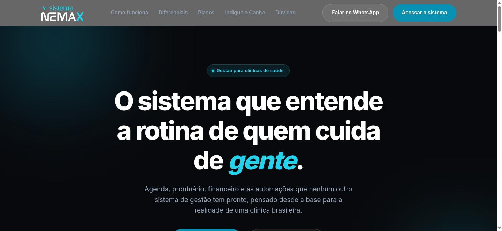
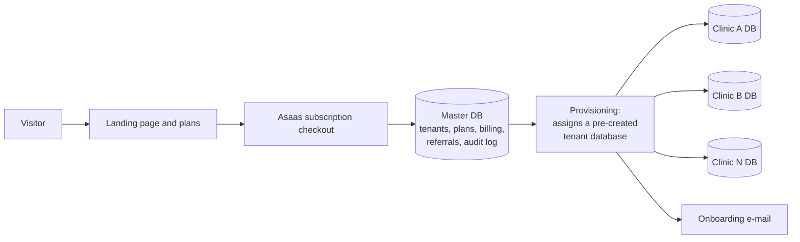

# Sistema NEMAX

### Multi-tenant SaaS for dental and health clinic management

> **Showcase repository.** Sistema NEMAX is a commercial product in production with paying clinics, so its source code is private. This repository documents the product, its architecture and the engineering decisions behind it.

  

---

## 🎯 The Problem

Small Brazilian clinics usually run on a mix of paper records, spreadsheets and generic scheduling apps. The tools built for them rarely handle what the local routine actually requires: the Receita Saúde tax receipt, signed treatment contracts, dental charts, prosthetic lab tracking and LGPD-compliant storage of sensitive patient data.

## ✅ The Solution

A web platform built around the daily routine of a Brazilian clinic, sold as a subscription with plan-based modules.

| Module | Description |
|---|---|
| 📅 **Multi-professional schedule** | Appointments per professional, with room blocking |
| 🗂️ **Patient records** | Medical history (anamnese), clinical chart and digital odontogram |
| 💰 **Financial** | Revenue and expense control, with the Receita Saúde receipt generated automatically on each payment |
| ✍️ **Digital signature via QR code** | Contracts and documents signed by the patient on their own phone, no paper or printer |
| 🦷 **Prosthetic control** | Tracks each prosthesis from the lab to installation |
| 🩻 **Exam import** | Radiology exams matched to the right patient automatically |
| 💬 **WhatsApp reminders** | Appointment reminders ready to send |
| 🤝 **Referral program** | Two-tier "Indique e Ganhe" program with PIX payouts and a built-in sales kit |

> The product interface is in Portuguese, as it targets the Brazilian market.

## 🏗️ Architecture

**Key decisions**

- **Database per tenant.** Each clinic has its own isolated database. A master database holds tenants, plans, billing, referrals and audit data. Isolation limits the impact of any bug or breach to a single clinic and makes per-clinic backup and restore simpler.
- **Pre-provisioned tenant pool.** Tenant databases are created ahead of time, so a new clinic is live right after payment, without waiting on database creation in shared hosting.
- **Field-level encryption.** CPF, medical history and signatures are encrypted with AES-256-GCM before reaching the disk, not only hidden in the interface.
- **Plan-based module gating.** Each subscription plan unlocks a specific set of modules for the clinic.
- **Billing integration.** Subscriptions run through the Asaas payment platform.

## 🔒 Security and LGPD

- Sensitive fields encrypted at rest (AES-256-GCM)
- Terms of use and privacy policy acceptance recorded with audit logging
- Brute-force protection on login, secure session cookies and hardened server configuration
- Role-based access: each user profile sees only what it needs

## 🛠️ Tech Stack

PHP 8.3 (no framework), MariaDB, vanilla HTML, CSS and JavaScript, PHPMailer for transactional e-mail, Asaas API for billing.

## 💡 What I Learned

Building a product that stores health data for paying customers changed how I design from the first table: isolation, encryption and audit trails have to be in the data model from day one, because adding them later means migrating every clinic. Running it alone, from architecture to billing and onboarding, also taught me to automate every step a customer would otherwise have to wait on.

---

Built by [Giuseppe Maset Neto](https://www.linkedin.com/in/giuseppemasetneto) · [sistemanemax.com.br](https://sistemanemax.com.br)

